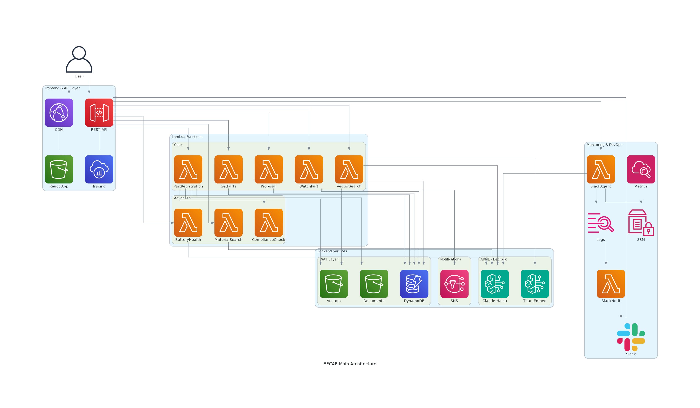
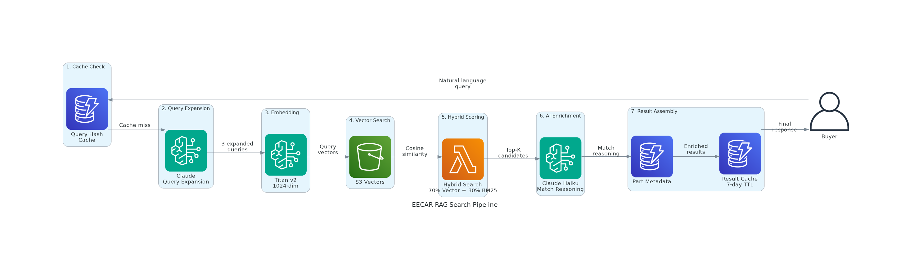
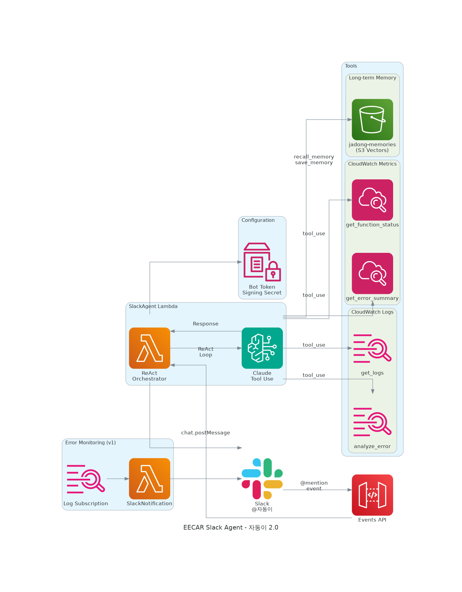

# EECAR - 전기차 중고 부품 B2B 거래 플랫폼

AI 기반 Hybrid RAG 검색을 활용한 전기차 부품 재활용 및 재사용 플랫폼

## 프로젝트 개요

EECAR는 1세대 전기차(2010년대 초반)의 수명 종료에 따라 증가하는 중고 부품의 효율적인 거래와 재활용을 지원하는 B2B 플랫폼입니다.

### 프로젝트 통계

| 항목 | 값 |
|------|-----|
| 코드베이스 | 10,000+ LOC |
| Lambda 함수 | 13개 (서버리스 마이크로서비스) |
| 부품 카테고리 | 11개 (배터리, 모터, 인버터, 차체 부품 등) |
| 배포 리전 | AWS ap-northeast-2 (서울) |

### 평가 체계

검색과 자동이 모두 변경 전에 평가 기준을 [결정 기록](docs/DECISION_LOG.md)에 먼저 커밋하고, 구성 선택에 쓰지 않은 별도 평가셋으로 확인한다.

| 대상 | 평가 방식 | 결과 |
|---|---|---|
| 부품 검색 | 별도 에이전트가 작성한 질의 160개, nDCG@10, 쌍체 부트스트랩 | 0.789 → 0.890 (+0.101 [+0.062, +0.142]) |
| 검색 회귀 | 운영 부품 186개 스냅숏 검사 16개 + 평가셋 순위 게이트를 CI에서 실행 | 조건 재정렬을 끄면 8/16만 통과 |
| 자동이 진단 (운영 구성) | 사전 등록한 홀드아웃 40개 × 3회, LLM Judge (Sonnet 4.6, 기준 판정 대비 κ 0.74) | 10.0% → 37.5% (+27.5%p [+15.0, +40.0]), Haiku 4.5 |
| 자동이 진단 (다음 구성 탐색) | 새 시나리오 24개 × 2회, 같은 LLM Judge | 33.3% → 72.9% (조회 도구 3종 + Sonnet 5.5 재진단, Haiku 5.5, Anthropic API 측정) |

- 검색 평가: [eval/README.md](eval/README.md)
- 자동이 평가: [eval/agent/README.md](eval/agent/README.md)
- 수치, 임계값, 기법 선택의 근거: [docs/DECISION_LOG.md](docs/DECISION_LOG.md)

### 시스템 아키텍처



## 주요 기능

### AI 기반 검색
- **하이브리드 검색**: 벡터 상위 100과 BM25 상위 100(한글 2-gram)을 각각 정규화한 뒤 같은 비중(α=0.5)으로 결합
- **질의 조건 재정렬**: 질의에서 카테고리, 수치(용량 등), 상태, 차종 조건을 뽑아 어긴 부품을 감점
- 검색 결과 7일 캐시, AI 추천 설명은 별도 요청(`/api/search/explain`)으로 받아 응답 지연과 분리



### 배터리 SOH 평가
- 70% 기준 재사용/재활용 자동 판단
- 17개 차종 데이터 기반 (현대 아이오닉, 테슬라 Model S, BMW i3 등)
- 6가지 양극재 타입 지원 (NCM Ni 33/60/80%, NCA, LFP, LMO)

### 재질 물성 검색
- 알루미늄 합금 기반 고급 검색 (6061, 7075, 5754)
- 인장 강도, 재활용률 등 물성 필터링

### 자동이 2.0 AI DevOps 어시스턴트
- `@멘션` 자연어 질의 → CloudWatch, 함수 설정, 권한, 코드 조회 → 원인과 근거를 구조화해 제출 (ReAct 패턴)
- 조치는 제안까지만 하고 실행하지 않음. 조회 권한만 부여
- Bedrock Knowledge Base + S3 Vectors 기반 장기 기억
- 에러 알림: 14가지 에러 타입 분류, 3단계 심각도, 같은 에러는 중복 제거
- 실행 지표는 CloudWatch EMF, 로그 속성은 OpenTelemetry GenAI 규약 적용



### 모니터링
- AWS X-Ray 분산 추적 (Lambda, API Gateway 전 구간)
- 검색 합성 검사: 정해진 질의 5개로 결과 조건, 후보 수, LLM 설명 폴백을 확인 (EventBridge Scheduler, 일정은 현재 꺼 둠)
- CloudWatch Dashboard 통합 모니터링

## 기술 스택

### Frontend
- React 18 + TypeScript + Vite
- TanStack Query (서버 상태 관리)
- React Context API (인증)

### Backend
- AWS Lambda (Node.js 24) - 13개 서버리스 함수
- Lambda Layer 공통 유틸리티

### AI/ML
- Amazon Bedrock Claude Haiku 4.5 (자동이, 검색 설명)
- Amazon Titan Text Embeddings V2
- 하이브리드 검색 (벡터 + BM25, 질의 조건 재정렬)
- S3 Vectors 벡터 저장소

### Infrastructure
- DynamoDB (싱글 테이블 디자인, 온디맨드 모드)
- S3 (벡터, 문서, 프론트엔드 호스팅)
- API Gateway + CloudFront (CDN)
- CloudWatch + X-Ray (모니터링)
- AWS SAM (IaC)

### DevOps
- GitHub Actions (7개 워크플로우)
- AWS OIDC (무-키 인증)
- Slack 알림 (배포, 에러 모니터링)
- Playwright E2E 테스트

### 평가
- Python + uv 검색 평가 하네스 (nDCG@10, 쌍체 부트스트랩, CI 회귀 게이트)
- 운영 오케스트레이터를 그대로 호출하는 에이전트 평가 + LLM Judge

## 프로젝트 구조

```
eecar/
├── frontend/              # React 프론트엔드
│   ├── src/
│   │   ├── pages/         # 페이지 컴포넌트
│   │   ├── components/    # 재사용 컴포넌트
│   │   └── data/          # Mock 데이터
│   └── vite.config.ts
├── backend/               # Lambda 함수들
│   ├── src/
│   │   ├── functions/     # Lambda 함수별 디렉토리 (13개)
│   │   └── utils/         # Lambda Layer 공통 유틸리티
│   ├── local-server/      # 로컬 개발용 Express mock 서버
│   └── package.json
├── shared/                # 공유 TypeScript 타입
├── infrastructure/        # AWS SAM 템플릿
├── e2e/                   # Playwright E2E 테스트
├── eval/                  # 검색 평가 하네스, 자동이 진단 평가
└── docs/                  # 문서, 결정 기록
```

### Lambda 함수 목록 (13개)

| 함수 | 설명 |
|------|------|
| vector-search | 하이브리드 검색, AI 추천 설명 |
| part-registration | 부품 등록 및 임베딩 생성 |
| compliance-check | 규정 준수 검증 |
| get-parts | 부품 조회 (카테고리/판매자 필터) |
| watch-part | 관심 부품 조건 등록 |
| proposal | B2B 계약 제안 |
| synthetic-data | 테스트 데이터 생성 |
| battery-health-assessment | 배터리 SOH 평가 |
| material-property-search | 재질 물성 검색 |
| contact-inquiry | 일반 문의 처리 (SNS) |
| slack-notification | Lambda 에러 모니터링 (v1: push) |
| slack-agent | 자동이 2.0 AI DevOps 어시스턴트 (v2: ReAct) |
| search-canary | 검색 합성 검사 (EventBridge Scheduler 매시 호출, 현재 꺼 둠) |

## 빠른 시작

### 사전 요구사항

- Node.js 24 (CI, Lambda 런타임과 같은 버전)
- Docker Desktop
- AWS CLI (배포 시)

### 설치 및 실행

```bash
# 1. 의존성 설치
npm run install:all

# 2. 전체 개발 환경 실행 (Docker + 백엔드 + 프론트엔드)
npm run dev:all
```

**접속 URL**:
- 프론트엔드: http://localhost:3000
- 백엔드 API: http://localhost:3001
- DynamoDB Admin: http://localhost:8001

### 빌드 및 배포

```bash
# 빌드 (backend에서 실행. 함수 + Lambda Layer)
cd backend && npm run build:all

# AWS 배포 (저장소 루트에서. 운영 배포는 태그 push로 CI가 수행)
npm run deploy
```


## CI/CD 파이프라인

### 워크플로우

| 워크플로우 | 트리거 | 역할 |
|-----------|--------|------|
| test-pipeline | PR, master/develop push | 유닛 테스트, 타입 체크, ESLint, 검색 회귀 게이트, E2E 테스트(master) |
| build-frontend | PR, frontend/** 변경 | 프론트엔드 빌드 검증 |
| deploy-frontend | master push | S3 + CloudFront 배포 |
| deploy-backend | v*.*.* 태그 | SAM 배포, Lambda 업데이트 |
| deploy-api-docs | schemas/types 변경 | OpenAPI 명세 생성 후 커밋 (GitHub Pages는 끔) |
| search-canary | 수동 실행 | 운영 검색 합성 검사 (결과 0건, LLM 폴백, 벡터 누락 탐지). 일정 실행은 EventBridge Scheduler가 맡고 현재는 꺼 둠 |
| security-scan | PR + 주간 스케줄 | 의존성 취약점 검사 |

### 배포 프로세스

```bash
# 프론트엔드 (자동 배포)
git push origin master

# 백엔드 (태그 기반)
git tag v1.0.0
git push origin v1.0.0
```

## API 엔드포인트


| 엔드포인트 | 메서드 | 설명 |
|-----------|--------|------|
| /api/search | POST | 하이브리드 검색 |
| /api/search/explain | POST | 검색 결과의 AI 추천 설명 |
| /api/parts | GET/POST | 부품 목록 조회/등록 |
| /api/parts/{id} | GET | 부품 상세 조회 |
| /api/watch | POST | 관심 부품 조건 등록 |
| /api/proposals | GET/POST | 계약 제안 조회/생성 |
| /api/battery-health | POST | 배터리 SOH 평가 |
| /api/material-search | POST | 재질 물성 검색 |
| /api/synthetic | POST | 테스트 데이터 생성 |
| /api/contact | POST | 일반 문의 |
| /api/slack/events | POST | Slack 이벤트 (자동이 2.0) |

전체 명세는 [docs/openapi.yaml](docs/openapi.yaml)


## 문의

- 프로젝트 관련 문의: dyseo521@gmail.com
